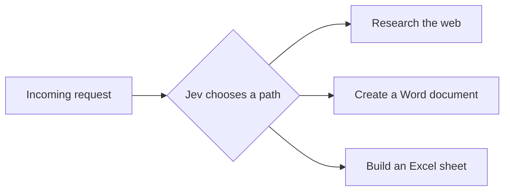

<p align="center">
  
</p>

<h1 align="center">Skarva</h1>

<p align="center"><strong>A lightweight desktop canvas for building AI agents.</strong></p>

<p align="center">
  
  
  <a href="LICENSE"></a>
</p>


Skarva is a Figma-like canvas for creating AI agents. Draw up a workflow and let [Jev](https://typesafe.ai/) decide which path to take. The app puts the requests together from the blocks you've connected, so you don't have to write the routing logic yourself. If Jev isn't confident enough, it stops and asks you.

For example, the same starting block can lead to different kinds of work:



## Use cases

- **An email support agent:** pick up an email through Gmail, figure out what it needs, and draft a reply. You check it before sending. One email per run for now.
- **An office assistant:** offload some repetitive work. Ask for a plan, spreadsheet, or presentation and have it attached to a reply.
- **A community event helper:** send it an idea for an event. Let it research options, make a planning sheet, or write a guide for the volunteers.

## How to use

1. Launch Skarva, choose **New project**, and select **Text workflow**.
2. Open **Integrations → AI model**. Choose OpenRouter, OpenAI, or Anthropic and save your API key and model ID.
3. Select the **Play** block, enter a request, and press **Play** in the toolbar. Your answer appears in Activity.

To try the Jev part, set up **Jev decisions** in Integrations and connect a block to a few possible next steps. You can also add a **Choice** or **Yes / No** block if you want a specific question in the workflow.

Prefer to explore first? Create a blank canvas and connect **Play → End**. That needs no account or API key.

## Run from source

Install [Rust](https://rustup.rs/), then:

```sh
git clone https://github.com/david-lockley/skarva.git
cd skarva
cargo run --release
```

If you're on Linux, you'll need a few [extra packages](docs/DEVELOPMENT.md#linux) first. On macOS and Windows, the usual Rust setup should be enough.

There's also an automated release workflow for macOS, Windows, and Linux. The packaging details are in the [release guide](docs/RELEASING.md).

I've been testing on macOS. Windows and Linux builds are set up too, but I could use help trying them on real machines. It's still an early project; the [checklist](docs/RELEASE_CHECKLIST.md) has the longer version of what's been tested.

## Future features

Some things I'd like to add, from smaller additions to the more ambitious stuff:

### Smaller steps

- **More integrations:** Microsoft 365, GitHub, and a look at what's possible with iOS and Meta.
- **More blocks:** programming, database searches, and maybe some 3D workflows further down the line.

### Bigger projects

- **Generate a workflow:** describe an agent and use a model through OpenRouter to draw up a starting canvas.
- **Run in the background:** start with the computer and wait for work. I'd like to look into Gmail push notifications rather than checking the inbox every 15 seconds. That needs a bit more setup on Google's side.
- **Headless deployment:** build an agent on the canvas, then export it to a separate program running on a local server.

### Experimental

- **Generate new blocks at runtime:** if a block is missing, let a model create it. A fun idea, but I'd need to work out how to run that code safely first.

## A lot of APIs

| Service                          | Used for                                           |
| -------------------------------- | -------------------------------------------------- |
| OpenRouter, OpenAI, or Anthropic | Writing, research queries, and Office file content |
| TypeSafe / Jev                   | Choosing among connected paths                     |
| Tavily                           | Web search                                         |
| Gmail                            | Receiving email and sending a reply you approve    |

You'll need your own API keys for the services you want to use. Gmail takes a little more setup because you need a Google OAuth client. I've put the steps in the [setup guide](docs/SETUP.md).

Projects are saved on your computer and API keys are stored encrypted. The blocks send what they need to the services you've connected, so keep that in mind before feeding it private files or work emails. It asks before sending an email.

## Controls

Drag blocks to move them. Drag a connection into empty space to add the next block. Box-select a group to move it together. Two fingers pan; pinch zooms. With a mouse, hold Space to pan. Ctrl/Command-D duplicates your selection; Delete removes selected blocks or connections.

## How it was built

The code was generated with OpenAI Codex, then worked on through a lot of testing and changes. Please keep that in mind before trusting it with anything important.

I wanted to keep it lightweight and easy to run, so it's built in Rust with egui/eframe. No web frontend.

## Contribute

If you try it, I'd love to hear what you made or what got in the way. Bug reports, design suggestions, and pull requests are welcome. See [CONTRIBUTING.md](CONTRIBUTING.md) if you want to help. For security issues, please use [SECURITY.md](SECURITY.md).

## License

[Apache-2.0](LICENSE). You're welcome to use it and build on it, including commercially. Just keep the license and required credits when sharing your version. Project credit is in [NOTICE](NOTICE); dependency and icon credits are in [THIRD_PARTY_NOTICES.md](THIRD_PARTY_NOTICES.md).
