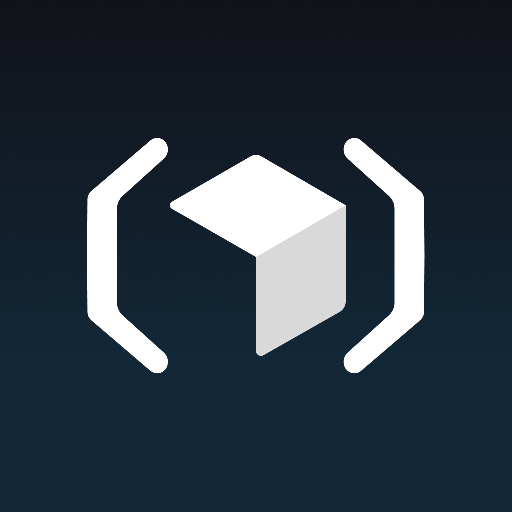
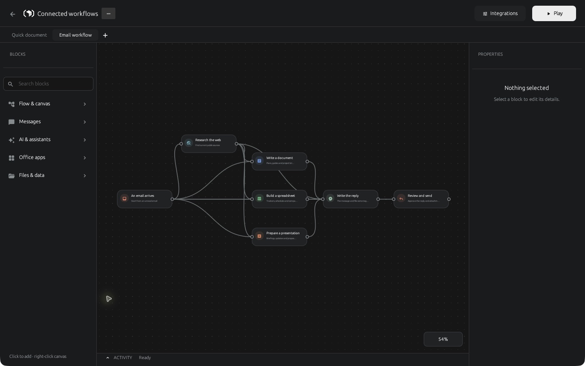
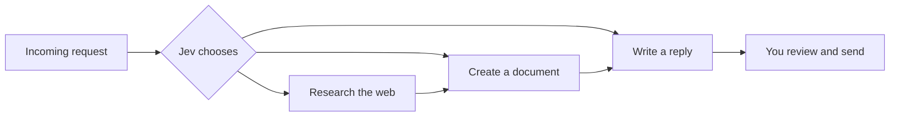

# Skarva

**Draw the workflow. Let Jev choose the path.**

Skarva is a desktop canvas for building agents out of connected blocks. Give it a request, connect a few possible actions, and let [Jev](https://typesafe.ai/) decide which path fits. Watch the run move through your canvas, inspect the result, and step in when a decision needs your judgment.





## What can you build?

- An inbox workflow that turns an email into research, a document, or a reply.
- A writing workflow that starts with a prompt and produces an editable Word file, spreadsheet, or presentation.
- A branching agent that uses a clear question to choose its next action, and pauses when confidence is low.

You connect the blocks; their outputs travel with them. A generated document becomes an email attachment automatically. Research and reference files become context for the next AI step. No separate variable wires to manage.

Built in Rust with a native GPU canvas. Projects stay on your computer. AI and research steps use the providers you connect.

## Try your first workflow

1. Launch Skarva, choose **New project**, and select **Text workflow**.
2. Open **Integrations → AI model**. Choose OpenRouter, OpenAI, or Anthropic and save your API key and model ID.
3. Select the **Play** block, enter a request, and press **Play** in the toolbar. Your answer appears in Activity.

Then add a second path from a block and connect **Jev decisions** to try routing. Every block can branch; you can also use an explicit **Choice** or **Yes / No** block.

Prefer to explore first? Create a blank canvas and connect **Play → End**. That needs no account or API key.

## Run from source

Install [Rust](https://rustup.rs/), then:

```sh
git clone https://github.com/david-lockley/skarva.git
cd skarva
cargo run --release
```

On Linux, install the [desktop build dependencies](docs/DEVELOPMENT.md#linux) first. macOS and Windows need their usual Rust compiler tools. Packaging scripts and CI builds are included for all three platforms.

**Current stage: early preview.** The app runs locally on macOS; Windows and Linux have build and packaging support, with automated checks configured. Check the [release checklist](docs/RELEASE_CHECKLIST.md) for what has actually been verified before distributing a build.

## Connect only what you need

| Service | Used for |
| --- | --- |
| OpenRouter, OpenAI, or Anthropic | Writing, research queries, and Office file content |
| TypeSafe / Jev | Choosing among connected paths |
| Tavily | Web search |
| Gmail | Receiving email and sending a reply you approve |

Bring your own keys. Provider charges and limits apply separately; a ChatGPT subscription does not include an API balance. Gmail currently requires your own Google Desktop OAuth client. [Connection setup →](docs/SETUP.md)

## A canvas that stays out of your way

Drag blocks to move them. Drag a connection into empty space to add the next block. Box-select a group to move it together. Two fingers pan; pinch zooms. With a mouse, hold Space to pan. Ctrl/Command-D duplicates your selection; Delete removes selected blocks or connections.

Projects save automatically. Import and export JSON workflows to share the structure without sharing service keys or conversation history. Review instructions and local file paths before running a workflow from someone else.

## Before you use real data

Email, files, and workflow context are sent to the providers used by your blocks. Service keys are encrypted locally with a master key in the OS credential store. Outgoing email always waits for **Approve & send**.

Skarva currently processes one email per run and carries one generated Office attachment. Office output supports basic text, tables, and slides. Teams, Outlook, and Copilot integrations are not available. [Setup, storage, and limitations →](docs/SETUP.md)

## Contribute

Bug reports, design feedback, and small focused pull requests are welcome. See [CONTRIBUTING.md](CONTRIBUTING.md) to get started and [SECURITY.md](SECURITY.md) for reporting security issues.

## License

Skarva is **source available and free for noncommercial use** under [PolyForm Noncommercial 1.0.0](LICENSE), including the personal and institutional uses described in that license. **Commercial use requires separate permission from the author.** Open an issue to discuss commercial licensing without posting private business information.

Dependencies keep their own licenses. See [third-party notices](THIRD_PARTY_NOTICES.md).
